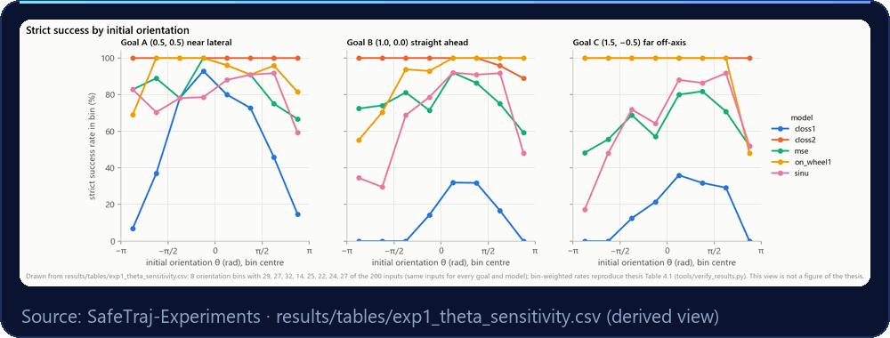
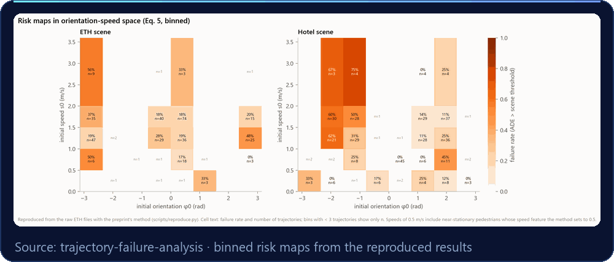
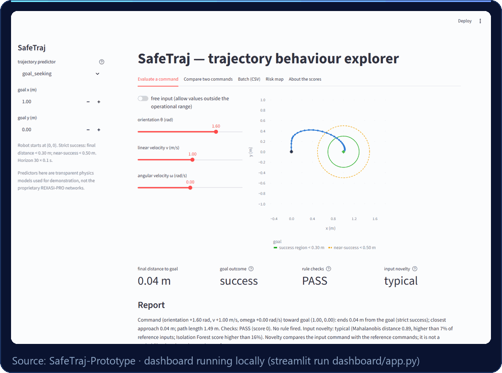
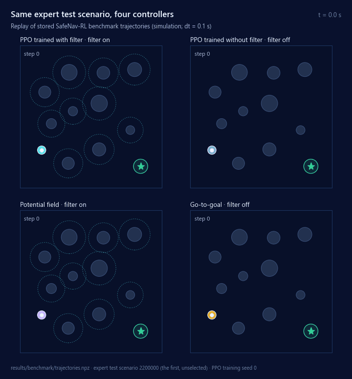
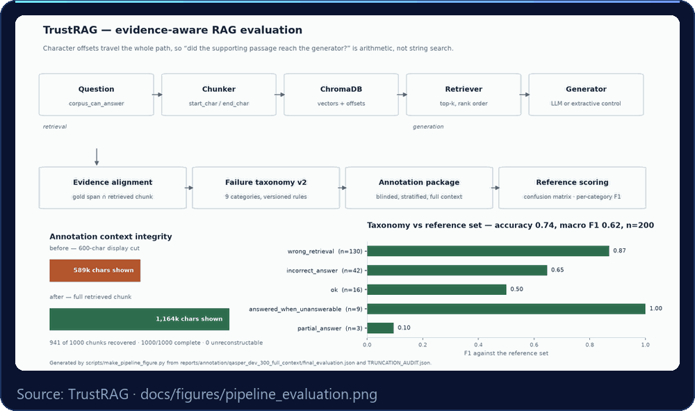

<picture>
  <source media="(prefers-reduced-motion: reduce)" srcset="assets/v2/banner-static.svg">
  
</picture>

  
  
  

I work on **trustworthy AI**: evaluating machine-learning systems, finding out *where* and *why* they fail, and explaining those failures with interpretable models. I build this as tested, reproducible research software, and I report what the evidence does not show as clearly as what it does.

**MSc in Computer Engineering, University of Genoa (2026).** I was a Research Assistant (MSc thesis research) at **CNR-IEIIT** in the EU Horizon Europe project [REXASI-PRO](https://rexasi-pro.spindoxlabs.com/), working on the reliability of neural trajectory predictors for smart-wheelchair navigation.

**Research interests:** failure analysis of learned components in safety-critical systems · ML evaluation (black-box evaluation, risk maps, held-out checks, confidence intervals, honest baselines) · interpretable models as failure rules · safety filters for learned navigation · reproducible research software · evidence-level evaluation of retrieval-augmented generation.

## Selected work

Each card links to its repository; the images are real outputs of those projects.

<table>
<tr>
<td width="50%" valign="top">

**[SafeTraj-Experiments](https://github.com/pouyapd/SafeTraj-Experiments)** · MSc thesis

Black-box evaluation of five pretrained neural trajectory predictors for a smart wheelchair (REXASI-PRO): 200 sampled commands × 3 goals per model. Strict success ranged from **25.3 % to 99.3 %** under identical conditions; failures concentrate at initial orientations near ±π, and depth-4 decision trees turn them into explicit rules. 42 checks recompute the thesis numbers from the published files.

</td>
<td width="50%" valign="top">

**[trajectory-failure-analysis](https://github.com/pouyapd/trajectory-failure-analysis)** · preprint

The same approach on real pedestrian trajectories (ETH dataset, 719 trajectories, two scenes) for a damped constant-velocity predictor. All 16 preprint values are reproduced from pinned raw data. Additional analyses show the limits: held-out tree accuracy does not exceed a constant baseline, and part of the positional signal in one scene is consistent with a horizon effect. [Preprint](https://doi.org/10.5281/zenodo.19513187), not peer-reviewed.

</td>
</tr>
<tr>
<td width="50%" valign="top">

**[SafeTraj-Prototype](https://github.com/pouyapd/SafeTraj-Prototype)** · toolkit

The failure-analysis workflow as a reusable tool for any trajectory predictor: trajectory metrics and rule checks, input-novelty percentiles (reported separately from outcomes, because a typical input can still fail), risk maps and decision-tree failure rules. One implementation behind a Python library, CLI, FastAPI service and Streamlit dashboard, with 46 tests. [Hosted API](https://safetraj-api.onrender.com/docs) (version 2.0.0, Render free tier).

</td>
<td width="50%" valign="top">

**[SafeNav-RL](https://github.com/pouyapd/SafeNav-RL)** · simulation

PPO navigation agents with a discrete-time control-barrier-function speed filter, its proof and stated assumptions, and a seeded multi-seed benchmark. With the filter on there were **no collisions in 3,600 test episodes**; the cost is deadlock (expert success 94.6 % → 65.0 % when the filter is added). Training with the filter did not clearly help: 76.4 % vs 70.0 % with sampled actions, with overlapping intervals.

</td>
</tr>
</table>

### [TrustRAG](https://github.com/pouyapd/TrustRAG): evidence localisation and failure attribution for RAG evaluation

A measurement study of what happens *inside* the right document: retrieving the correct document is not the same as ranking the passage that supports the answer first.

- Seven localisers (BM25, dense bi-encoders and cross-encoder rerankers; 22M–278M parameters) on QASPER and Natural Questions, with a retrieval decomposition on four corpora.
- An author-conducted annotation of 200 QASPER units: gating failure attribution on span coverage agrees with the labels more often than gating on document coverage (accuracy 0.700 vs 0.600). One annotator: agreement with a guided expert reading, not independent validation.
- A defect found in my own BM25 baseline led to withdrawing an earlier result; the correction is kept on record in the repository.

Offset-carrying pipeline, failure taxonomy, Wilson intervals, exact McNemar with Holm correction, cluster bootstrap; 504 tests. Software and annotation data on Zenodo: [10.5281/zenodo.22879358](https://doi.org/10.5281/zenodo.22879358), [10.5281/zenodo.22879569](https://doi.org/10.5281/zenodo.22879569).

### [GroundedAI](https://github.com/pouyapd/GroundedAI): evidence-grounded document question answering

<a href="https://github.com/pouyapd/GroundedAI"><picture>
  <source media="(prefers-reduced-motion: reduce)" srcset="assets/v2/cards/groundedai.png">
  
</picture></a>

**[▶ Try the live demo](https://pouyapd.github.io/GroundedAI/)** (runs entirely in your browser; no install) · [Repository](https://github.com/pouyapd/GroundedAI) · [Release v0.1.0](https://github.com/pouyapd/GroundedAI/releases/tag/v0.1.0)

A retrieval-augmented question-answering application that checks its own answers: every statement is compared with the passages the model received and comes back with a status, the exact quoted sentence and its page. Conflicting sources are shown side by side, and when the documents do not say, the answer is "not enough evidence".

- The live demo runs the unchanged FastAPI backend in the browser (Python compiled to WebAssembly): PDF extraction, hybrid retrieval, the prompt and the claim check, with an optional Qwen2.5-1.5B model on the visitor's GPU (WebGPU).
- With qwen2.5:1.5b through Ollama on a 56-question synthetic set, 29 of 41 answerable questions were answered correctly with every statement verified, and 8 of 10 questions that should be refused were refused. The checks are lexical and rule-based, and the labels were written by the author or by models.

FastAPI · LangChain · SQLite FTS5 or PostgreSQL + pgvector · React · Pyodide · WebLLM; a browser check of the live demo runs in CI.

## Tools I use in these projects

- **ML and evaluation:** Python · PyTorch · scikit-learn · NumPy · pandas · SciPy · Gymnasium · Matplotlib
- **LLM and retrieval:** sentence-transformers · BM25 · cross-encoder rerankers · ChromaDB · LangChain · Ollama · WebLLM · OpenAI and Anthropic APIs
- **Software:** FastAPI · Streamlit · pytest · GitHub Actions · Docker · Prometheus · Git

## Other projects

- [superstore-analysis](https://github.com/pouyapd/superstore-analysis): end-to-end BI workflow with Python, SQL and Power BI.

## Contact

[LinkedIn](https://www.linkedin.com/in/pouya-pourmand-021654325) · pouyapd68@gmail.com

The banner's project map is a diagram of the repositories above; its motion is CSS-only, and a still version is shown when your system asks for reduced motion. The project images are figures and a screenshot from those repositories, the SafeNav-RL animation replays its stored benchmark trajectories, and the GroundedAI animation is a recording of its live demo. All are generated by <a href="tools/make_profile_v2_assets.py"><code>tools/make_profile_v2_assets.py</code></a>.
