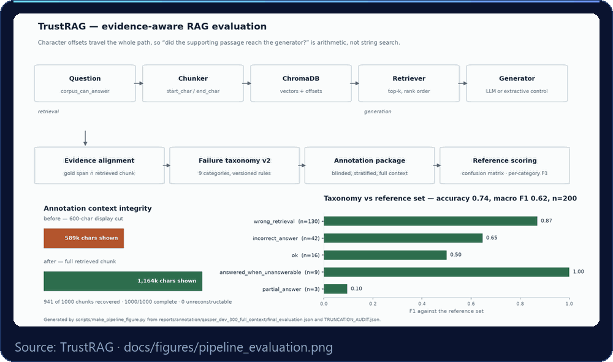
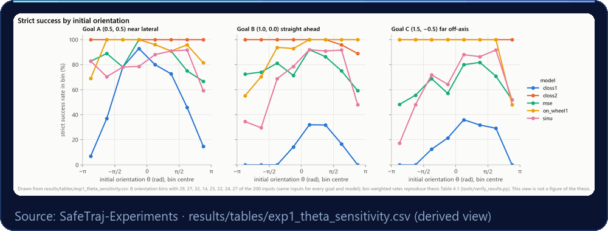
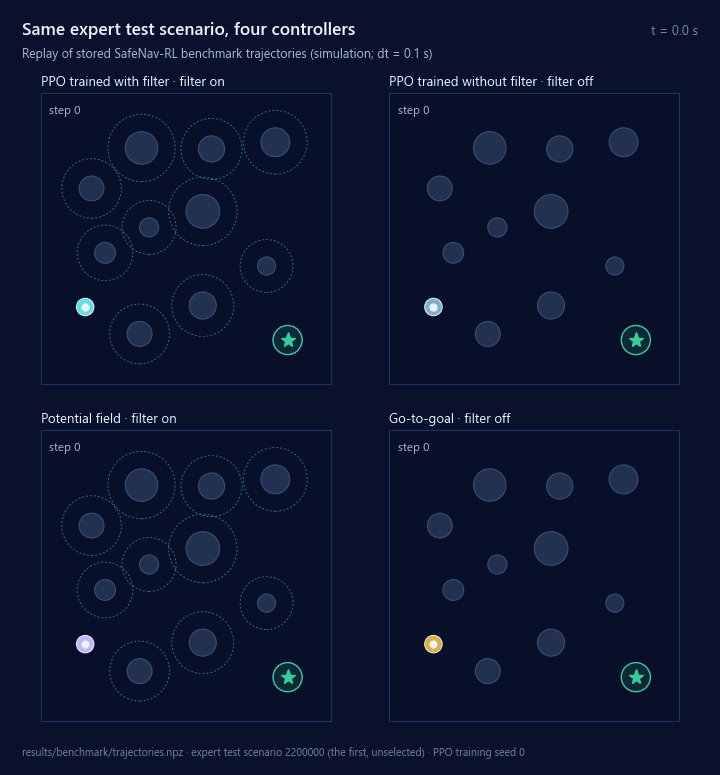
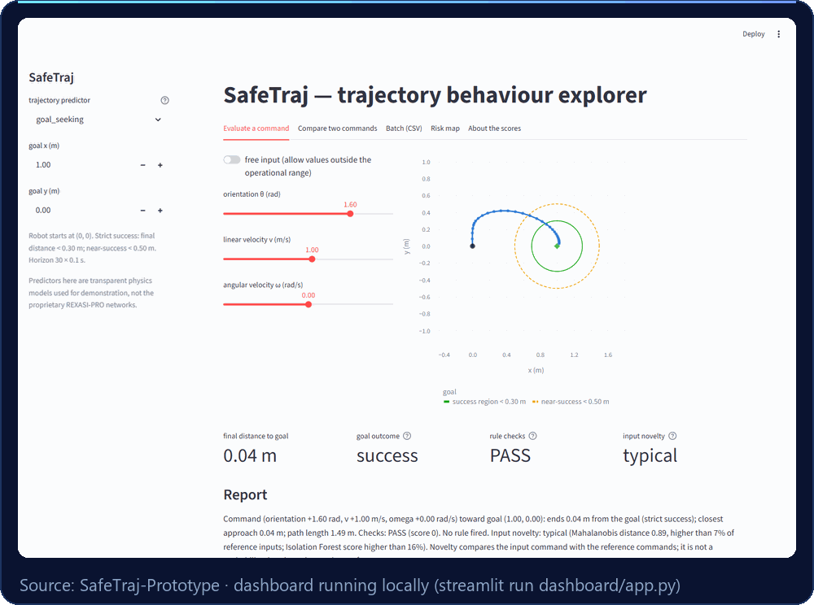
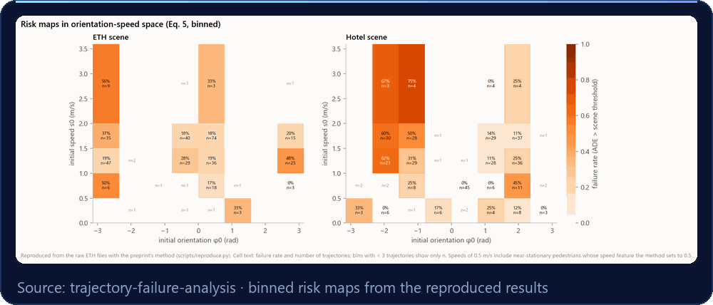

<picture>
  <source media="(prefers-reduced-motion: reduce)" srcset="assets/v2/banner-static.svg">
  
</picture>

  
  
  
  

**Applied AI / ML Engineer · RAG & LLM systems · trustworthy AI evaluation.** I build machine-learning and LLM applications in Python and test whether their output can be trusted: where they fail, why, and what a change really improves on held-out data. My code comes with tests, CI and stated limits.

**MSc in Computer Engineering (Artificial Intelligence curriculum), University of Genoa, July 2026.** My MSc thesis research was carried out in collaboration with **CNR-IEIIT** within the EU Horizon Europe project [REXASI-PRO](https://cordis.europa.eu/project/id/101070028), on the reliability of neural trajectory predictors for smart-wheelchair navigation.

**What I work with:** RAG pipelines (hybrid retrieval, reranking, citation checks) · LLM evaluation and fine-tuning (LoRA) · Python backends with FastAPI and PostgreSQL + pgvector · model evaluation with held-out test sets and confidence intervals · failure analysis of learned components in robotics.

I am looking for Applied AI / ML engineering roles in Europe, especially Germany.

## Applied AI: RAG and LLM systems

### [GroundedAI](https://github.com/pouyapd/GroundedAI): evidence-grounded document question answering

<a href="https://github.com/pouyapd/GroundedAI"><picture>
  <source media="(prefers-reduced-motion: reduce)" srcset="assets/v2/cards/groundedai.png">
  
</picture></a>

**[▶ Try the live demo](https://pouyapd.github.io/GroundedAI/)** (runs entirely in your browser; no install) · [Repository](https://github.com/pouyapd/GroundedAI) · [Release v0.1.0](https://github.com/pouyapd/GroundedAI/releases/tag/v0.1.0)

Evidence-grounded question answering over PDFs: every statement of an answer comes back with the exact quoted sentence, its page and source label, and a list of the checks that ran (citation labels, lexical match, question relevance, disagreement between sources and, optionally, meaning). When the documents do not say, the answer is "not enough evidence".

- **Retrieval and checks:** hybrid retrieval (BM25 + vectors, reciprocal rank fusion) with page-aware chunks; an optional NLI meaning check (DeBERTa-v3-xsmall, int8 ONNX) runs in the browser next to the lexical check. On 108 hand-written test claims it reached macro-F1 .716, against .388 for the lexical check.
- **Runs in the browser:** the live demo runs the real Python backend as WebAssembly (Pyodide), with an optional Qwen2.5-1.5B-Instruct base model on the visitor's GPU (WebLLM).
- **Evaluated on real PDFs:** ten NIST publications split by document, 53 hand-written test questions run once per configuration, paired bootstrap intervals.
- **LoRA fine-tuning experiment:** Qwen2.5-1.5B-Instruct fine-tuned with LoRA on a free Colab T4 and compared with the base model under identical retrieval and decoding. The adapter followed the citation format in every reply (53 of 53, against 27 for the base model) but answered fewer test questions correctly (23 of 40, against 34), so it was not adopted and the base model stays the default ([results](https://github.com/pouyapd/GroundedAI/blob/main/docs/FINETUNING.md)).

FastAPI · LangChain · SQLite FTS5 or PostgreSQL + pgvector · Alembic · React + TypeScript · Pyodide · WebLLM · ONNX Runtime Web · Docker; 8 CI jobs, including PostgreSQL, the Docker image and a browser check of the live demo.

### [TrustRAG](https://github.com/pouyapd/TrustRAG): evidence localisation and failure attribution for RAG evaluation

A measurement study of what happens *inside* the right document: retrieving the correct document is not the same as ranking the passage that supports the answer first. Code and results of a manuscript submitted to *Language Resources and Evaluation* (September 2026).

- Seven localisers (BM25, dense bi-encoders and cross-encoder rerankers; 22M–278M parameters) on QASPER and Natural Questions, with a retrieval decomposition on four corpora.
- An author-conducted annotation of 200 QASPER units: gating failure attribution on span coverage agrees with the labels more often than gating on document coverage (accuracy 0.700 vs 0.600). One annotator: agreement with a guided expert reading, not independent validation.
- A defect found in my own BM25 baseline led to withdrawing an earlier result; the correction is kept on record in the repository.

Offset-carrying pipeline, failure taxonomy, Wilson intervals, exact McNemar with Holm correction, cluster bootstrap; FastAPI service, Docker, 573 tests. Software and annotation data on Zenodo: [10.5281/zenodo.22879358](https://doi.org/10.5281/zenodo.22879358), [10.5281/zenodo.22879569](https://doi.org/10.5281/zenodo.22879569).

## Trustworthy AI for robotics and autonomous systems

Each card links to its repository; the images are real outputs of those projects. All robot results are from offline evaluation or simulation, not from a physical robot.

<table>
<tr>
<td width="50%" valign="top">

**[SafeTraj-Experiments](https://github.com/pouyapd/SafeTraj-Experiments)** · MSc thesis

Black-box evaluation of five pretrained neural trajectory predictors for a smart wheelchair (REXASI-PRO): 200 sampled commands × 3 goals per model. Strict success ranged from **25.3 % to 99.3 %** under identical conditions; failures concentrate at initial orientations near ±π, and depth-4 decision trees turn them into explicit rules. 42 checks recompute the thesis numbers from the published files.

</td>
<td width="50%" valign="top">

**[SafeNav-RL](https://github.com/pouyapd/SafeNav-RL)** · simulation

PPO navigation agents with a discrete-time control-barrier-function speed filter, its proof and stated assumptions, and a seeded multi-seed benchmark. With the filter on there were **no collisions in 3,600 simulated test episodes**; the cost is deadlock (expert success 94.6 % → 65.0 % when the filter is added). Training with the filter did not clearly help: 76.4 % vs 70.0 % with sampled actions, with overlapping intervals.

</td>
</tr>
<tr>
<td width="50%" valign="top">

**[SafeTraj-Prototype](https://github.com/pouyapd/SafeTraj-Prototype)** · toolkit

The failure-analysis workflow as a reusable tool for any trajectory predictor: trajectory metrics and rule checks, input-novelty percentiles (reported separately from outcomes, because a typical input can still fail), risk maps and decision-tree failure rules. One implementation behind a Python library, CLI, FastAPI service and Streamlit dashboard, with 46 tests. [Hosted API](https://safetraj-api.onrender.com/docs) (version 2.0.0, Render free tier).

</td>
<td width="50%" valign="top">

**[trajectory-failure-analysis](https://github.com/pouyapd/trajectory-failure-analysis)** · preprint

The same approach on real pedestrian trajectories (ETH dataset, 719 trajectories, two scenes) for a damped constant-velocity predictor. All 16 preprint values are reproduced from pinned raw data. Additional analyses show the limits: held-out tree accuracy does not exceed a constant baseline, and part of the positional signal in one scene is consistent with a horizon effect. [Preprint](https://doi.org/10.5281/zenodo.19513187), not peer-reviewed.

</td>
</tr>
</table>

## Tools I use in these projects

- **LLM and retrieval:** Hugging Face Transformers · PEFT/LoRA · sentence-transformers · BM25 · cross-encoder rerankers · NLI verification · LangChain · Ollama · WebLLM · ONNX Runtime · ChromaDB · pgvector
- **ML and evaluation:** Python · PyTorch · scikit-learn · NumPy · pandas · SciPy · Gymnasium · Matplotlib
- **Backend and engineering:** FastAPI · SQLAlchemy and Alembic · PostgreSQL · SQLite · Docker · GitHub Actions · pytest · Playwright · Prometheus-format metrics · React with TypeScript · Streamlit · Git

## Other projects

- [superstore-analysis](https://github.com/pouyapd/superstore-analysis): end-to-end BI workflow with Python, SQL and Power BI.
- [AdventureWorks-SQL-Project](https://github.com/pouyapd/AdventureWorks-SQL-Project): SQL Server analysis and data-quality queries on AdventureWorks2019.

## Contact

[LinkedIn](https://www.linkedin.com/in/pouya-bathaei-pourmand-021654325/) · pouyapd68@gmail.com · Genoa, Italy, open to relocation in Europe

The banner's project map is a diagram of the repositories above; its motion is CSS-only, and a still version is shown when your system asks for reduced motion. The project images are figures and a screenshot from those repositories, the SafeNav-RL animation replays its stored benchmark trajectories, and the GroundedAI animation is a recording of its live demo made by <a href="tools/record_groundedai_demo.py"><code>tools/record_groundedai_demo.py</code></a>. All are framed by <a href="tools/make_profile_v2_assets.py"><code>tools/make_profile_v2_assets.py</code></a>.
